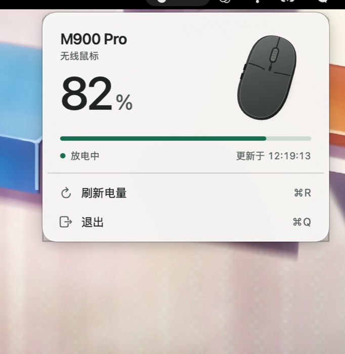

# Delux M900 Pro 电量 · MouseBattery

macOS 菜单栏小工具：实时显示 **多彩 Delux M900 Pro**（2.4G 8K 接收器）无线鼠标的电量。

macOS 本身对这类走 2.4G dongle 的鼠标拿不到电量（蓝牙鼠标才有系统级电池上报），
而厂商驱动是 Windows 专用 / 网页版。这个工具直接读接收器 HID 通道里的状态帧。


| 放电中 | 充电中 | 深色模式 |
|---|---|---|
|  |  |  |

## 功能

- 菜单栏常驻：鼠标图标 + 百分比，充电时换成闪电图标
- 点开是一张卡片：电量、进度条、状态（放电中 / 充电中 / 离线）、最后更新时间
- `⌘R` 刷新、`⌘Q` 退出、`Esc` 或点别处收起
- 充电时**不显示 100%**：此时读数被充电电压顶满，是假值，卡片显示"上次已知电量"
- 鼠标关机/离开范围时静默判离线（15s 无帧），显示上次电量并标注已离线
- 深浅色自动跟随系统，动效克制（0.14s 展开、悬停 0.12s、按压 0.09s）

## 为什么充电时没有实时电量

实测（`0330400351` → 上底座 → 3 秒后 `0330400364`）：一放上充电底座，电量字节就跳到 `0x64`(100)，
取下后过 2 秒才落回真实值。官方 Compx/Delux 网页驱动对这种情况的处理是"连续读到 8 次 100 才采信"，
并在有电压字段时改用电压换算。这个接收器的状态帧里没有电压字段，所以充电时只能给出"上次已知电量"，
这是数据本身的限制，不是解析问题。

## 协议（逆向结果）

设备：`1d57:fa65`，product string 为 `2.4G 8K HS Receiver`（LXDDZ），4 个 interface / 8 个 collection。

- **没有 feature report**：`get_feature_report()` 对 report id 0..255 全部返回 `OSError: read error`
  （hidapi 把 macOS 的 `kIOReturnUnsupported` 映射成这个空消息异常）。想发命令只能走 interrupt OUT。
- 厂商 collection（usage page `0xFF00`）在 IOKit 里**不是独立的 IOHIDDevice**，它是 System Control
  那个 device 的 usage pair 之一，要用 `kIOHIDDeviceUsagePairsKey` 找。
- 两个键盘接口（usage 6）被 macOS 独占，普通权限打不开，属正常现象。

接收器每 ~4 秒主动推一帧 5 字节状态包（含 report ID）：

| 字节 | 值 | 含义 |
|---|---|---|
| `buf[0]` | `0x03` | report ID |
| `buf[1]` | `0x30` | 常量 |
| `buf[2]` | `0x40` | 常量 |
| `buf[3]` | flags | bit0 = 鼠标链路在线，bit1 = 充电中 |
| `buf[4]` | 0x00–0x64 | 电量百分比（充电时为不可信的 100） |

状态刚切换的那一帧会先给一个 `0x64` 占位值，约 2 秒后落到真实值；鼠标关机时整条链路静默，一帧都不来。

## 编译

```bash
git clone https://github.com/coderlife-book/delux-m900-pro-battery
cd delux-m900-pro-battery
```

需要 macOS + Xcode Command Line Tools（`xcode-select --install`）。

```bash
./build.sh
open MouseBattery.app
```

## 开机自启

```bash
mkdir -p ~/Library/LaunchAgents
cat > ~/Library/LaunchAgents/local.mousebattery.plist <<EOF
<?xml version="1.0" encoding="UTF-8"?>
<!DOCTYPE plist PUBLIC "-//Apple//DTD PLIST 1.0//EN" "http://www.apple.com/DTDs/PropertyList-1.0.dtd">
<plist version="1.0"><dict>
  <key>Label</key><string>local.mousebattery</string>
  <key>ProgramArguments</key>
  <array><string>$PWD/MouseBattery.app/Contents/MacOS/MouseBattery</string></array>
  <key>RunAtLoad</key><true/>
</dict></plist>
EOF
launchctl load ~/Library/LaunchAgents/local.mousebattery.plist
```

## 命令行版

`mouse_battery.py` 是不带界面的等价实现（依赖 `pip install hidapi`），适合脚本/状态栏之外的地方调用：

```bash
python3 mouse_battery.py            # 打印一次：82%  放电中
python3 mouse_battery.py --watch    # 变化时打印
python3 mouse_battery.py --json     # {"online":true,"charging":false,"level":82,...}
```

## 已知限制

- **同一时刻只能有一个进程读这个设备**：hidapi / IOHID 对该 collection 是独占打开，
  命令行工具和菜单栏 app 同时跑会有一个报 `open failed`。二选一。
- 只在这一个型号（`1d57:fa65`）上验证过。同系列不同批次可能换 VID/PID 或帧格式；
  换设备的话改 `MouseBattery.swift` 顶部的 `kVID` / `kPID`，再按上面的表核对字节。
- 全程**只读**：不向设备写任何字节，也不打开鼠标/指针 collection（不会抢走指针）。

## 调试开关

```bash
MB_DEBUG=1          ./MouseBattery.app/Contents/MacOS/MouseBattery   # 打印收到的帧
MB_SHOWCARD=2       ...   # 启动 2 秒后自动展开卡片（截图用）
MB_APPEARANCE=dark  ...   # 强制深色
MB_FAKE=charging    ...   # 注入假状态：charging / offline / empty
```

## License

[MIT](LICENSE)
