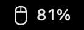
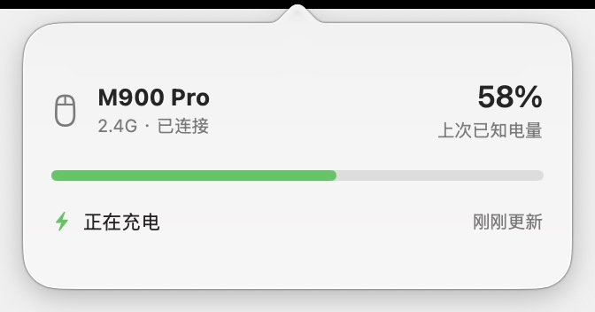
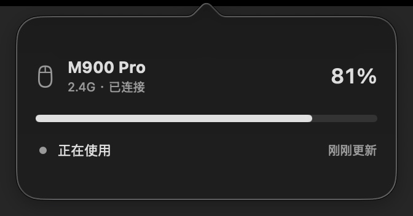

# MouseBattery

在 macOS 菜单栏查看 **Delux M900 Pro** 的电量和充电状态。适配 **2.4G 8K 接收器**（`1d57:fa65`）。

[从源码编译](#从源码编译) · [下载预编译版](#下载预编译版)



| 浅色模式 | 充电中 | 深色模式 |
| :---: | :---: | :---: |
|  |  |  |

*截图来自当前源码，电量为演示数据。*

## 快速开始

### 从源码编译

需要 **macOS 13+** 和 Xcode 命令行工具（`xcode-select --install`）。

```bash
git clone https://github.com/coderlife-book/delux-m900-pro-battery
cd delux-m900-pro-battery
./build.sh
open MouseBattery.app
```

### 下载预编译版

[下载 v1.1.0（Apple Silicon，macOS 13+）](https://github.com/coderlife-book/delux-m900-pro-battery/releases/tag/v1.1.0)。解压后将 `MouseBattery.app` 拖入 `/Applications`。Intel Mac 可从源码编译。

<details>
<summary>首次打开时被 macOS 拦截</summary>

发行包采用临时签名（ad-hoc）。可尝试在访达中右键应用，选择「打开」。如果仍被拦截，对下载的应用执行以下命令后再打开。

```bash
xattr -dr com.apple.quarantine /Applications/MouseBattery.app
open /Applications/MouseBattery.app
```

</details>

## 使用

- **左键**点击菜单栏图标，查看电量、连接状态和更新时间。再点一次或点击浮层外即可收起。
- **右键**点击图标，刷新电量或退出应用。
- 在线时显示「刚刚更新」。连续 15 秒没有状态帧时判为离线，更新时间按分钟更新。
- **充电或离线**时显示上次已知电量，没有可用读数时显示 `—`。

## 工作原理

应用通过 IOKit **只读**监听接收器广播的 HID 状态帧。其他批次的接收器可能使用不同的 VID/PID 和帧格式。菜单栏应用与命令行工具需要分开运行，同一时刻只有一个进程能读取该通道。

充电时，接收器可能在几秒内从 81% 跳报到 100%（`0330400351` → `0330400364`）。这个占位值不能代表实时电量，状态帧也没有可用于换算的电压字段。官方 Windows 驱动在充电期间显示动画，Compx/Delux 网页驱动会等待连续 8 次读到 100%，并优先用电压字段估算。

<details>
<summary>HID 协议和接收器细节</summary>

`2.4G 8K HS Receiver`（LXDDZ）有 4 个接口和 8 个 collection。厂商接口的 report 如下。

| 方向 | Report ID | Payload | Usage page | 用途 |
| --- | --- | --- | --- | --- |
| Input | `0x01` | 1 B | `0x01` | System Control |
| Input | `0x02` | 2 B | `0x0C` | Consumer |
| Input | `0x03` | 4 B | `0x0A` | 电量状态帧 |
| Input | `0x04` | 63 B | `0xFF00` | 厂商通道 |
| Output | `0x04` | 63 B | `0xFF00` | 厂商通道 |

接收器约每 4 秒广播一次 `03 <model> <event> <state> <level>`。共 5 字节，包含 report ID。

| 字节 | 含义 | 值 |
| --- | --- | --- |
| `buf[0]` | Report ID | `0x03` |
| `buf[1]` | 型号 | 本机接收器报 `0x30`，官方驱动也用该字段区分其他型号 |
| `buf[2]` | 事件 | `0x40` 电量，`0x10` DPI，`0x20` 回报率，`0x50` 命令 ACK |
| `buf[3]` | 状态码 | `1` 放电，`2` 已充满，`3` 充电中 |
| `buf[4]` | 电量 | `0x00`–`0x64`，充电期间的读数不可信 |

- 状态切换时首帧可能报 `0x64` 占位值，约 2 秒后恢复。鼠标关机后，接收器停止推送电量状态帧。
- 厂商 collection 是 System Control 设备的 usage pair。通过 `kIOHIDDeviceUsagePairsKey` 定位。应用只监听该通道，不打开鼠标或指针 collection。
- 接收器没有 feature report，也没有官方工具用于设置 DPI、灯效和回报率的 `0x0B` 通道。探测 `get_feature_report()` 会返回 IOKit 的 `kIOReturnUnsupported`。
- 两个键盘接口（usage 6）由 macOS 独占。

协议中型号、事件和状态字段的含义参考了 [omarchy-delux-m900 的逆向记录](https://github.com/AeonArcHQ/omarchy-delux-m900/blob/HEAD/docs/re/findings.md)。该 Linux 项目适配带 feature report 的 `1d57:fa60` 接收器。

</details>

## 进阶

<details>
<summary>开机自启</summary>

在源码目录构建应用后执行。

```bash
mkdir -p ~/Library/LaunchAgents
cat > ~/Library/LaunchAgents/local.mousebattery.plist <<EOF_PLIST
<?xml version="1.0" encoding="UTF-8"?>
<!DOCTYPE plist PUBLIC "-//Apple//DTD PLIST 1.0//EN" "http://www.apple.com/DTDs/PropertyList-1.0.dtd">
<plist version="1.0"><dict>
  <key>Label</key><string>local.mousebattery</string>
  <key>ProgramArguments</key>
  <array><string>$PWD/MouseBattery.app/Contents/MacOS/MouseBattery</string></array>
  <key>RunAtLoad</key><true/>
</dict></plist>
EOF_PLIST
launchctl load ~/Library/LaunchAgents/local.mousebattery.plist
```

</details>

<details>
<summary>命令行工具与调试</summary>

退出菜单栏应用后，可用 Python 直接读取设备。

```bash
python3 -m pip install hidapi
python3 mouse_battery.py          # 显示一次电量
python3 mouse_battery.py --watch  # 电量状态变化时输出
python3 mouse_battery.py --json   # 输出 JSON
```

从源码目录启动应用时，可设置这些环境变量。

| 环境变量 | 效果 |
| --- | --- |
| `MB_DEBUG=1` | 打印收到的 HID 帧 |
| `MB_SHOWCARD=2` | 启动两秒后自动展开浮层 |
| `MB_APPEARANCE=dark` | 强制深色外观 |
| `MB_FAKE=charging` | 模拟充电。也可用 `offline` 或 `empty` |

```bash
MB_DEBUG=1 ./MouseBattery.app/Contents/MacOS/MouseBattery
```

</details>

## 许可证

[MIT](LICENSE)
